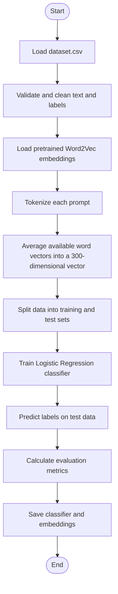
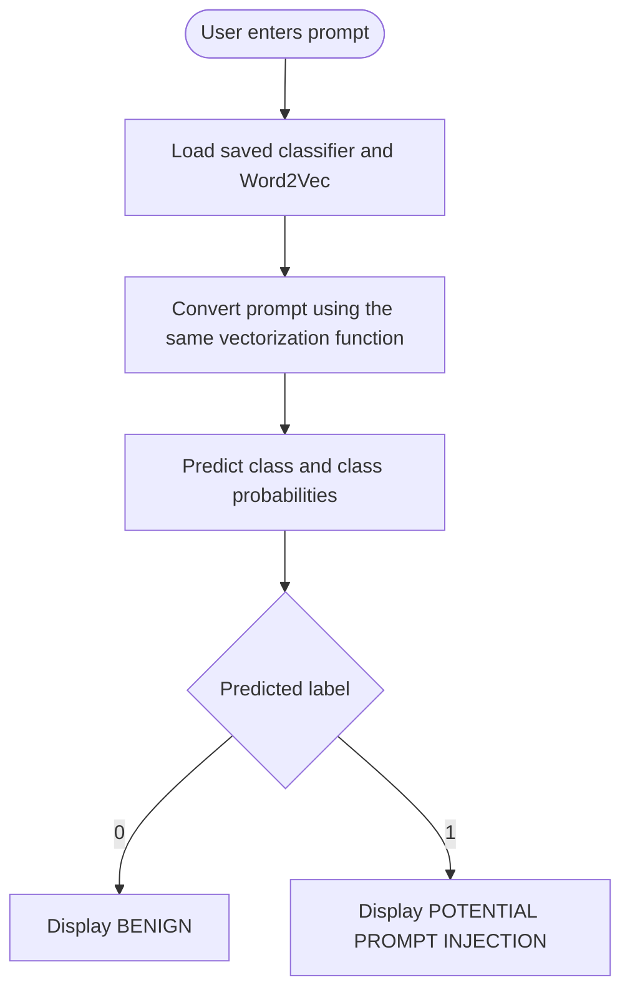

# Prompt Injection Detection Model

A machine-learning project that classifies text prompts as **Benign** or **Potential Prompt Injection** using pretrained Word2Vec embeddings and a Logistic Regression classifier.

> **Note:** This is a research/learning baseline, not a complete security solution. It can miss malicious prompts and incorrectly flag benign text.

## Table of Contents
- [Overview](#overview)
- [How It Works](#how-it-works)
- [Dataset](#dataset)
- [Model Evaluation](#model-evaluation)
- [Confusion Matrix](#confusion-matrix)
- [Project Structure](#project-structure)
- [Installation](#installation)
- [Usage](#usage)
- [Important Code Components](#important-code-components)
- [Metrics Explained](#metrics-explained)
- [Limitations](#limitations)
- [Future Improvements](#future-improvements)
- [Conclusion](#conclusion)

## Overview

Prompt injection is an attack in which text attempts to make an AI system ignore or override its intended instructions. This project builds a binary text classifier:

- **Label `0` — Benign:** ordinary or non-injection prompt.
- **Label `1` — Injection:** prompt labelled as a prompt injection in the dataset.

The model uses:
- **Word2Vec:** maps known words to numeric vectors.
- **Mean pooling:** averages known word vectors into one fixed-length vector per prompt.
- **Logistic Regression:** learns to classify the resulting vectors.

## How It Works



### Prediction flow



## Dataset

The project uses `dataset.csv`, reported to contain **29,019 rows** and two columns:

| Column | Description |
|---|---|
| `text` | Prompt or input text |
| `label` | Target class: `0` for benign, `1` for injection |

The reported evaluation used **5,804 test examples**:
- Benign support: 2,446
- Injection support: 3,358

Keep the dataset's source and licence information with the project if known. Do not publish private, restricted, or unlicensed data.

## Model Evaluation

Reported results from the current run:

| Metric | Result |
|---|---:|
| Training accuracy | 83.48% |
| Test accuracy | 82.68% |
| Injection precision | 85.99% |
| Injection recall | 83.71% |
| Injection F1-score | 84.83% |
| Benign precision | 78.42% |
| Benign recall | 81.28% |
| Benign F1-score | 79.82% |
| Macro-average precision | 82.21% |
| Macro-average recall | 82.49% |
| Macro-average F1-score | 82.33% |
| Weighted-average precision | 82.80% |
| Weighted-average recall | 82.68% |
| Weighted-average F1-score | 82.72% |

These are results on the reported test split, not a guarantee of performance on real-world attacks. The reported training and testing accuracies differ by **0.80 percentage points**. This small gap is encouraging, but it does not rule out data leakage or weaknesses in the test data.

## Confusion Matrix

Rows are actual labels; columns are predicted labels.

| Actual \ Predicted | Benign | Injection |
|---|---:|---:|
| Benign | 1,988 (True Negative) | 458 (False Positive) |
| Injection | 547 (False Negative) | 2,811 (True Positive) |

- **True Negative (TN): 1,988** — benign prompts correctly identified.
- **False Positive (FP): 458** — benign prompts incorrectly flagged as injections.
- **False Negative (FN): 547** — injections incorrectly classified as benign.
- **True Positive (TP): 2,811** — injections correctly identified.

For a security detector, false negatives deserve special attention because they represent missed injection prompts. False positives also matter because they can disrupt legitimate use.

## Project Structure

```text
Prompt Injection Detection Model/
├── main.py
├── evaluate_model.py
├── prediction.py
├── dataset.csv
└── models/
    ├── prompt_injection_model.joblib
    ├── word2vec_model.kv
    └── word2vec_model.kv.vectors.npy
```

- `main.py` — loads and processes data, trains/evaluates the classifier, and saves model artifacts.
- `evaluate_model.py` — loads saved artifacts and evaluates predictions on the reproducible test split.
- `prediction.py` — loads the saved artifacts and predicts on newly entered prompts.
- `dataset.csv` — input prompts and labels.
- `models/` — saved Logistic Regression classifier and Word2Vec embeddings. Keep the `.npy` companion file next to the `.kv` file.

## Installation

Use Python and install the libraries used by the project. From your activated virtual environment:

```bash
pip install numpy pandas scikit-learn gensim joblib
```

If the project has a `requirements.txt`, prefer installing the pinned dependencies from that file:

```bash
pip install -r requirements.txt
```

The pretrained Word2Vec model may require an initial download if it is not already cached. Ensure you have the appropriate access and enough disk space.

## Usage

Run commands from the project root, with your virtual environment activated.

### Train and save the model

```bash
python main.py
```

### Evaluate saved model artifacts

```bash
python evaluate_model.py
```

### Predict new prompts

```bash
python prediction.py
```

Follow the prompt shown in the terminal. Type `exit` if the script supports it to quit.

## Important Code Components

### 1. Convert a prompt into a vector

The same vectorization logic must be used in training, evaluation, and prediction.

```python
def get_sentence_vector(text, wv):
    words = re.findall(r"[A-Za-z0-9_]+", text)
    vectors = []

    for word in words:
        for token in (word, word.lower(), word.capitalize()):
            if token in wv:
                vectors.append(wv[token])
                break

    if not vectors:
        return np.zeros(wv.vector_size, dtype=np.float32)

    return np.mean(vectors, axis=0).astype(np.float32)
```

This function averages the vectors for words found in Word2Vec. Unknown words are ignored; if none are found, it returns a zero vector.

### 2. Train the classifier

Essential example only; match the split and preprocessing in your actual training script for reproducible metrics.

```python
model = LogisticRegression(
    max_iter=1000,
    class_weight="balanced",
    random_state=42
)
model.fit(X_train, y_train)
```

- `max_iter=1000` is the solver's maximum iteration limit, not 1,000 epochs.
- `class_weight="balanced"` adjusts class weights based on class frequencies in the training data.

### 3. Save and load model files

```python
# Save
joblib.dump(model, "models/prompt_injection_model.joblib")
wv.save("models/word2vec_model.kv")

# Load
model = joblib.load("models/prompt_injection_model.joblib")
wv = KeyedVectors.load("models/word2vec_model.kv")
```

## Metrics Explained

| Metric | Meaning | Formula |
|---|---|---|
| Accuracy | Fraction of all predictions that are correct | `(TP + TN) / (TP + TN + FP + FN)` |
| Precision (injection) | Of prompts predicted as injection, fraction truly injection | `TP / (TP + FP)` |
| Recall (injection) | Of actual injections, fraction detected | `TP / (TP + FN)` |
| F1-score | Harmonic mean of precision and recall | `2 × (Precision × Recall) / (Precision + Recall)` |
| Specificity / benign recall | Of actual benign prompts, fraction correctly identified | `TN / (TN + FP)` |
| False-positive rate | Fraction of benign prompts incorrectly flagged | `FP / (FP + TN)` |
| False-negative rate | Fraction of injections missed | `FN / (FN + TP)` |
| Macro average | Average across classes, giving each class equal weight | Unweighted class average |
| Weighted average | Average across classes weighted by class support | Support-weighted class average |
| Support | Number of actual examples in a class | Count per class |

Using the reported confusion matrix:
- Accuracy = `(2811 + 1988) / 5804` = **82.68%**
- Injection precision = `2811 / (2811 + 458)` = **85.99%**
- Injection recall = `2811 / (2811 + 547)` = **83.71%**
- Injection F1-score = **84.83%**
- False-positive rate = `458 / 2446` = **18.72%**
- False-negative rate = `547 / 3358` = **16.29%**

## Limitations

- Averaging word embeddings loses word order and contextual meaning.
- Words not covered by the pretrained embedding vocabulary are ignored.
- The dataset may contain duplicates or similar examples across training and testing splits; this should be checked.
- Test metrics depend on dataset quality and class distribution.
- `predict_proba` values are model outputs and are not automatically calibrated probabilities of real-world attack success.
- A text classifier alone cannot reliably prevent all prompt injection attacks and should not be the only security control.

## Future Improvements

1. Check exact and near-duplicate examples across data splits.
2. Inspect the 547 false negatives to identify missed attack patterns.
3. Compare against a **TF-IDF + Logistic Regression** baseline using the same validation protocol.
4. Tune the decision threshold on a validation set, balancing missed injections against false alarms.
5. Evaluate on an independent dataset from sources not used for training.
6. Test paraphrases, unseen attack patterns, benign security discussions, long inputs, and out-of-vocabulary text.
7. Consider contextual embeddings or a suitable transformer classifier if compute and dataset size allow.
8. Record dataset provenance, licence, package versions, split strategy, and random seed.

## Conclusion

This project implements an end-to-end baseline for binary prompt-injection classification using pretrained Word2Vec embeddings and Logistic Regression. The reported test accuracy is **82.68%**, with **85.99% injection precision**, **83.71% injection recall**, and an **84.83% injection F1-score**. Training accuracy is **83.48%**, a gap of **0.80 percentage points** from test accuracy. The results are a useful starting point, but the model still produced **458 false positives** and **547 false negatives**. The next priorities are to audit data quality and duplicates, study missed injections, compare a TF-IDF baseline, and evaluate on an independent unseen dataset. The detector should be used as one layer of a broader security strategy, not as a guarantee that prompts are safe.
